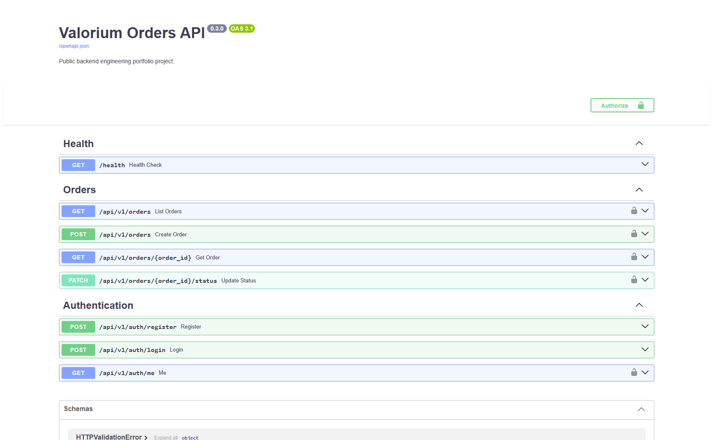
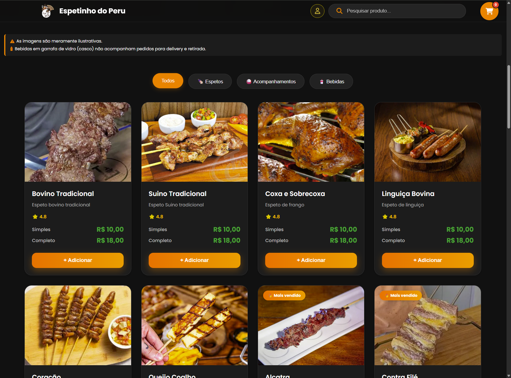
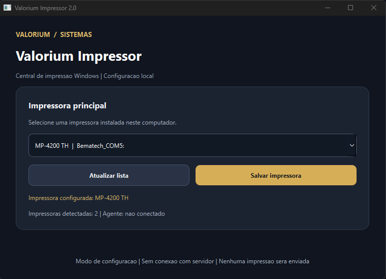
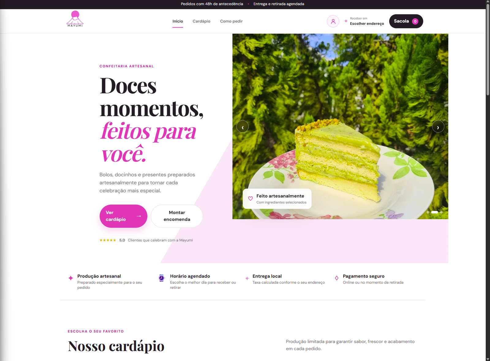
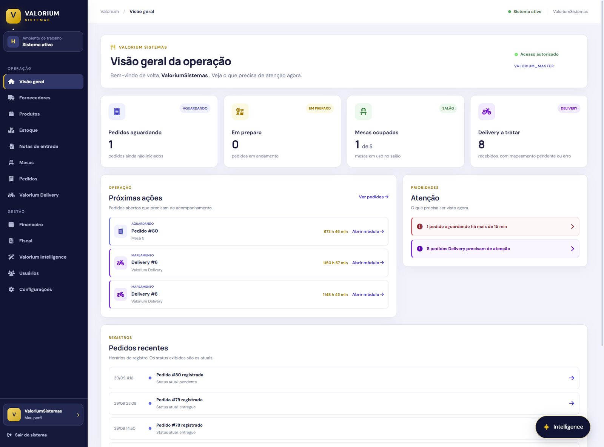

# Guilherme Langkammer

### Software Developer · Backend & Full Stack · Oracle Cloud Infrastructure

**Building business software, integrations and automation with an infrastructure-first perspective.**

---

## About Me

I'm a **software developer** and **founder of Valorium Sistemas**, where I build web applications, business management platforms and integration tools using **PHP, JavaScript, Python and SQL**.

I also work as an **Oracle Cloud Infrastructure (OCI) Administrator at DB IT**, supporting cloud environments and troubleshooting networking, connectivity and infrastructure issues. My background connects software engineering with real-world operations.

- **Focus:** Backend development, Full Stack applications, systems integration and automation
- **Education:** Software Engineering, Faculdade Anhanguera — expected graduation **December 2026**
- **Currently learning:** Java and Kotlin
- **Career interests:** Software engineering opportunities in Brazil and internationally

## Professional Experience

| Role | Organization | Period |
| --- | --- | --- |
| **Founder & Full Stack Developer** | **Valorium Sistemas** | Jan 2026 – Present |
| **Oracle Cloud Infrastructure Administrator** | **DB IT** | May 2022 – Present |

**Valorium Sistemas:** Develop customer-facing web applications and administrative systems; implement business rules, database operations, integrations, and user experience improvements.

**DB IT:** Support OCI environments, investigate network and application connectivity issues, and work with VCNs, routing, NSGs, VPN/IPsec, load balancers and Oracle Database connectivity.

## Technical Skills

**Languages & Web**

**Data, Tools & Cloud**

## Featured Engineering Projects

A selection of public backend engineering projects and real-world commercial software case studies, featuring system architecture, workflows, integrations, and application screenshots. Public projects include source code and documentation; proprietary commercial implementations are presented without exposing private code or customer data.

| Project | What I built | Engineering focus |
| --- | --- | --- |
| **[Valorium Orders API](https://github.com/Guilherme-Langkammer/valorium-orders-api)** | Public REST API with authentication, order management, database migrations and automated tests | Python · FastAPI · SQLAlchemy · JWT · Docker · CI/CD |
| **[Valorium Delivery](https://github.com/Guilherme-Langkammer/valorium-delivery-showcase)** | Online ordering storefront and business operations dashboard | PHP · JavaScript · SQL · Order workflows |
| **[Valorium Impressor](https://github.com/Guilherme-Langkammer/valorium-impressor-showcase)** | Windows printing integration agent for web-based orders | Python · Windows · SQLite · Print queues |
| **[Mayumi Confeitaria](https://github.com/Guilherme-Langkammer/valorium-mayumi-showcase)** | Custom confectionery storefront and administration platform | PHP · JavaScript · SQL · Commerce UX |
| **[Valorium Sistemas](https://github.com/Guilherme-Langkammer/valorium-sistemas-showcase)** | Modular business management ecosystem | Full Stack · Business logic · Integrations |

### Valorium Orders API

**Backend Engineering · Python · FastAPI · SQLAlchemy · JWT · Docker**

Public backend portfolio project featuring RESTful order management, authentication, database migrations, automated tests and GitHub Actions CI.

**Verified:** 29 automated tests passing locally, with successful Backend CI and Docker CI runs.

[Explore source code and documentation](https://github.com/Guilherme-Langkammer/valorium-orders-api) · [Backend CI](https://github.com/Guilherme-Langkammer/valorium-orders-api/actions/workflows/tests.yml) · [Docker CI](https://github.com/Guilherme-Langkammer/valorium-orders-api/actions/workflows/docker.yml)

*Independent public portfolio project; proprietary Valorium Sistemas source code is not included.*

---
### Valorium Delivery

A web-based ordering experience connected to administrative workflows for products, orders and delivery operations. **Key challenges:** application modularity, database integration, order lifecycle and responsive interfaces.

[View architecture and screenshots](https://github.com/Guilherme-Langkammer/valorium-delivery-showcase)

*Customer storefront — product discovery, category navigation and ordering interface.*

### Valorium Impressor

A Python-based Windows agent designed to bridge web ordering systems and locally installed printers. **Key challenges:** printer discovery, configuration, print-job workflows and error handling.

[View architecture and screenshots](https://github.com/Guilherme-Langkammer/valorium-impressor-showcase)

*Windows configuration interface — installed-printer selection. Agent connectivity is not active in this screenshot.*

### Mayumi Confeitaria

A tailored storefront and administration platform for a confectionery business. **Key challenges:** product presentation, promotions, permissions, ordering workflows and maintainable interfaces.

[View architecture and screenshots](https://github.com/Guilherme-Langkammer/valorium-mayumi-showcase)

*Customer storefront — responsive visual design, product presentation and ordering entry points.*

### Valorium Sistemas

A modular business management ecosystem focused on operational workflows, administrative tools and integrations. **Key challenges:** translating business requirements into maintainable application modules.

[View engineering case study](https://github.com/Guilherme-Langkammer/valorium-sistemas-showcase)

*Operations dashboard — order overview, workflow priorities and recent activity. Figures reflect the captured environment, not audited business metrics.*

> **Transparency:** These repositories are engineering showcases, not open-source releases. Some documented diagrams represent design goals or work in progress rather than independently verified production features.

## Currently Developing

I'm strengthening my backend engineering skills with a focus on **API design, automated tests, reliable integrations and maintainable software architecture**. Java and Kotlin are currently learning areas, not professional specializations.

## Let's Connect

I'm open to **Backend Developer**, **Full Stack Developer** and **Software Developer** opportunities, as well as collaboration on software and automation projects.

[LinkedIn](https://www.linkedin.com/in/guilherme-de-paula-langkammer-1a64b0344/) · [Email](mailto:guilhermelangkammer008@gmail.com) · [GitHub](https://github.com/Guilherme-Langkammer)

---

Build · Integrate · Automate · Improve

